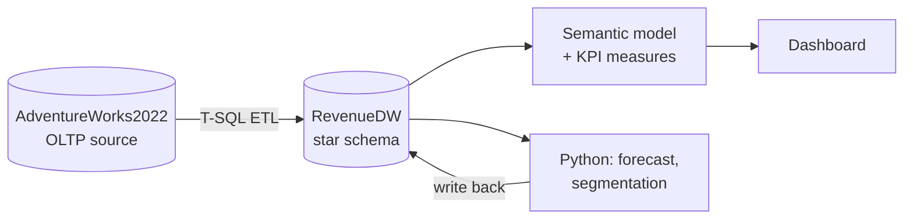
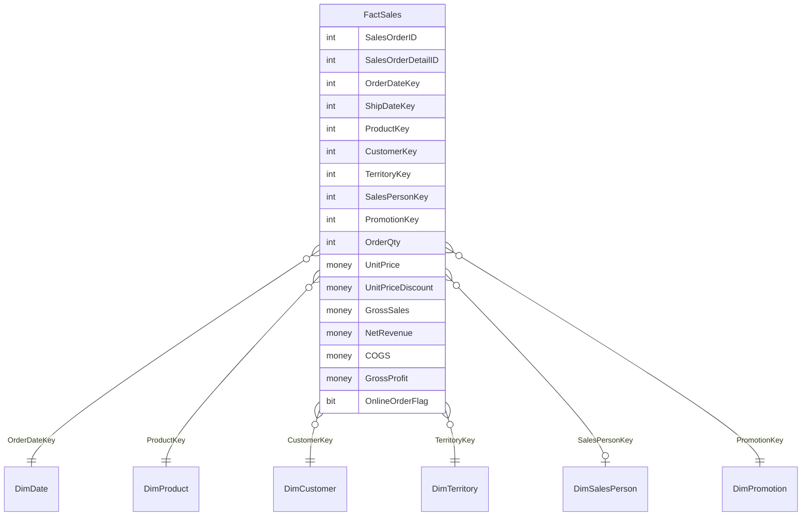

# 02 - Data Architecture

## 1. Overview

**Pattern:** Extract from OLTP -> transform into a dimensional model -> serve to BI. Python results are written back to the warehouse so the dashboard has a single data source.

## 2. Warehouse layers

| Schema | Purpose |
|---|---|
| `stg` | Raw copies of needed source tables (optional, for isolation) |
| `dw` | Dimensions and facts (the model BI reads) |
| `ds` | Data science outputs (forecast, segments, anomalies) |

## 3. Dimensional model

**Fact grain:** one row per sales order line (`SalesOrderDetailID`).

### Order-level amounts
`Freight` and `TaxAmt` live on the order header. Keep them in a separate **`FactOrder`** (grain: one row per order) to avoid double-counting when joining to line-level data. Fulfilment days and Freight % come from `FactOrder`.

## 4. Dimension specifications

| Dimension | Natural key | Key attributes | Source tables |
|---|---|---|---|
| `DimDate` | Date | Year, Quarter, Month, Month Name, Week, Day of Week, Fiscal flags, Is Latest Month | generated |
| `DimProduct` | ProductID | Name, Number, Color, Size, Category, Subcategory, ListPrice | `Production.Product`, `ProductSubcategory`, `ProductCategory` |
| `DimCustomer` | CustomerID | Customer Type (Individual/Store), Name, Store Name, City, Region | `Sales.Customer`, `Person.Person`, `Sales.Store` |
| `DimTerritory` | TerritoryID | Territory Name, Country, Group (North America / Europe / Pacific) | `Sales.SalesTerritory` |
| `DimSalesPerson` | BusinessEntityID | Name, Territory, Quota, Bonus, Commission % | `Sales.SalesPerson`, `Person.Person` |
| `DimPromotion` | SpecialOfferID | Description, Type, Category, Discount %, Start/End | `Sales.SpecialOffer` |

Each dimension uses an integer surrogate key plus the natural key. Include an "Unknown" member (key = -1) for missing values such as online orders with no sales rep.

## 5. ETL design

1. **Create** schemas and tables (`sql/01-03`)
2. **Load dimensions** first (`DimDate`, then others)
3. **Load facts** with surrogate key lookups
4. **Run data quality checks** (`sql/05`); abort and log if any critical check fails
5. **Log** each run: start/end time, rows loaded, status

Make loads **idempotent** (re-runnable with the same result), using truncate-and-reload for v1.

## 6. Data quality checks

| Check | Rule | Severity |
|---|---|---|
| Revenue reconciliation | `SUM(NetRevenue)` in fact equals `SUM(LineTotal)` in source | Critical |
| Row count | Fact rows = source `SalesOrderDetail` rows | Critical |
| Orphan keys | No fact rows with unmatched dimension keys | Critical |
| Duplicates | No duplicate `SalesOrderDetailID` in fact | Critical |
| Nulls | No NULL in `OrderDateKey`, `ProductKey`, `CustomerKey` | Critical |
| Negative values | No negative quantities or revenue | Warning |
| Date logic | `ShipDate >= OrderDate` | Warning |
| Missing cost | Products without cost history flagged | Warning |

## 7. Decision log

| # | Decision | Rationale | Alternative considered |
|---|---|---|---|
| D1 | Build a star schema instead of reporting off OLTP | Faster, simpler measures, standard industry practice | Direct queries on source tables |
| D2 | Fact grain = order line | Enables product-level profit and discount analysis | Order-level only |
| D3 | Revenue = `LineTotal` (net of discount, excludes tax and freight) | Reflects true sales value | `TotalDue` (includes tax and freight) |
| D4 | COGS from `ProductCostHistory` by order date | Cost changes over time; `Product.StandardCost` is only the current value | Static `StandardCost` (simpler, less accurate) |
| D5 | Separate `FactOrder` for header-level amounts | Prevents freight/tax double counting | Allocate freight to lines |
| D6 | Unknown member (-1) in dimensions | Keeps online orders without rep in the model | Drop rows with NULL rep |
| D7 | T-SQL ETL first | Lowest barrier; Python/SSIS orchestration added later | Python ETL from the start |

## 8. Naming conventions

- Tables: `PascalCase` with `Dim` / `Fact` prefix
- Keys: `<Entity>Key` (surrogate), `<Entity>ID` (natural)
- SQL files numbered in execution order
- Commit messages: `type: short description` (e.g., `feat: add DimProduct load`)
